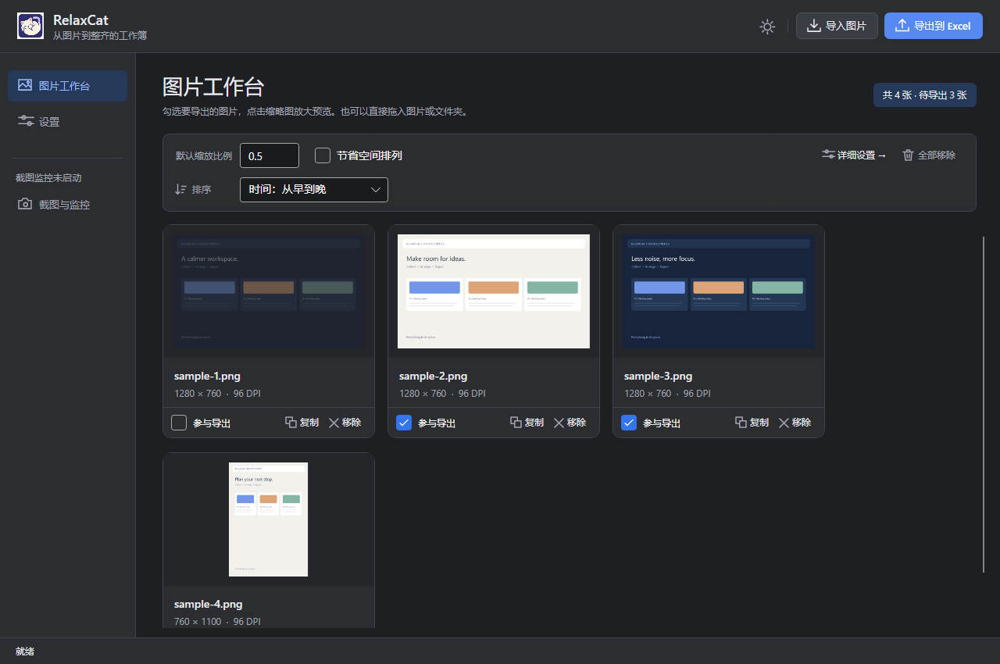
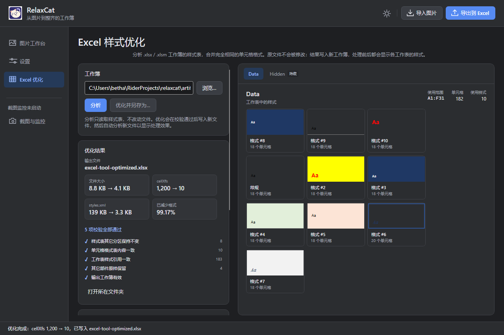

# RelaxCat

Windows 截图收集与 Excel 排版工具。支持把图片或文件夹直接拖入窗口、文件夹自动监控、手动导入，提供图片卡片与放大预览、DPI 感知缩放、有序规则、逐行/节省空间排列，以及真实 Excel COM 导出；可选择捆绑的 Greenshot 截图。另提供完全离线的 Excel 样式分析/去重工具，显示工作表样式与优化前后效果，并输出到新工作簿。界面使用 Avalonia XAML + C#，支持明亮/黑暗主题和简体中文、日本語、English、한국어切换。

## 下载

从 [Releases](https://github.com/nanaminato/relaxcat/releases/latest) 下载 Windows x64 便携版，解压后进入 `RelaxCat-v<版本>-win-x64` 文件夹运行 `RelaxCat.App.exe`：

- **完整便携版**（`RelaxCat-v*-win-x64.zip`）：包含 .NET 10 运行时，无需另行安装。
- **轻量版**（`RelaxCat-v*-win-x64-framework-dependent.zip`）：不含运行时，需要安装 [.NET 10 x64 Runtime](https://dotnet.microsoft.com/download/dotnet/10.0)。不要求 Desktop Runtime；只有 .NET 8/9 不能代替 .NET 10。

需要 Windows 10 或更新版本、x64。Excel 导出需要本机安装桌面版 Microsoft Excel；没有 Excel 时仍可导入与预览。

## 界面预览

| 图片工作台（浅色） | 图片工作台（深色） |
| :---: | :---: |
|  |  |

| 放大预览 | Excel 排版设置 |
| :---: | :---: |
|  |  |

| Excel 样式分析 | 优化结果（明亮） | 优化结果（黑暗） |
| :---: | :---: | :---: |
|  |  |  |

| Excel 批量优化 |
| :---: |
|  |

## 从源码运行

需要 .NET 10 运行时与构建用 .NET SDK 10.0.300（见 `global.json`）。

```powershell
dotnet run --project src/RelaxCat.App -c Release
```

也可启动构建生成的 `src/RelaxCat.App/bin/Release/net10.0-windows/RelaxCat.App.exe`。

1. 点击「导入图片」选择本地 PNG、JPEG 或 BMP，或把多张图片、文件夹直接拖入窗口——文件夹会递归导入子文件夹中的图片。首页以卡片展示每张图片；取消「参与导出」勾选可保留图片但不导出。卡片上的「复制」复制原始图片到剪贴板，「移除」只移出队列，不删除源文件。
2. 点击缩略图打开放大预览：支持适应窗口、缩放与滚动、上一张/下一张，左右方向键切换，Esc 或点击背景关闭。预览中的勾选框与卡片同步。
3. 首页提供默认缩放比例、节省空间排列、排序与全部移除。点击左侧「设置」或「详细设置」，在「尺寸与规则」「Excel 排版」「外观与语言」独立设置页面调整其他选项。空模板使用 Excel 默认模板。顶部「切换明暗」也可快速切换主题。
4. 点击「导出到 Excel」，仅按队列顺序导出已勾选图片。首次创建工作簿，后续复用，导出前清空目标工作表中的全部图片并重新排版（保留单元格内容和非图片图形）；如果已关闭则重新创建。导出前会重新规范工作表行高、列宽，可能影响该工作表的原有内容。
5. 在 Excel 中自行保存。关闭 RelaxCat 不会强行关闭已导出的工作簿。主题、语言、导出、截图和排序设置会自动保存，重启后恢复；图片队列仍仅保留在当前会话。连续输入会合并保存，关闭时立即保存。设置文件带版本号和备份，主文件损坏时尝试备份，两者都无效时使用默认设置并提示。

## 工作区整理

- 默认按文件最后修改时间从早到晚排列，导入完成后自动插入到正确位置，也适用于监控收到的新截图。可以切换为从晚到早或导入顺序；相同时间保持导入顺序。文件时间在导入时读取，之后修改磁盘文件不会自动重新排序。
- 也可以把多张图片或文件夹拖入窗口导入：文件夹按名称顺序递归展开子文件夹，同一张图片重复拖入只导入一次，非图片文件忽略；无法读取的文件夹在状态栏提示，其余内容照常导入。
- 导出和预览沿用当前工作区顺序；排序不会改变图片的导出勾选状态。
- 「全部移除」清空所有图片并释放预览和缩略图，只移出工作区，保留源文件及 Excel 中已导出的内容。导入或导出过程中不可清空；监控继续运行，后续新截图仍会进入工作区。

## 截图与文件夹监控

1. 点击左侧「截图与监控」，选择「Greenshot（随应用捆绑）」或「仅监控文件夹」，指定截图文件夹，然后点击「应用并启动」。默认关闭，不会在未选择时接管系统截图。
2. Greenshot 模式首次启动会从随应用分发的 ZIP 校验并解压官方便携预发行包，无需另装 Greenshot。当前捆绑版本为 `1.4.371-g78211b16d9`，适用于 Windows 10+ x64，需要 .NET Framework 4.8。来源、校验和及上游许可证位于 `vendor/greenshot/`，发布目录也包含这些文件。
3. 首次初始化后保留 Greenshot 的独立配置。截图快捷键、输出方式和保存目录请在 Greenshot 自身的设置中调整；RelaxCat 启动集成时读取保存目录。修改保存目录后在 RelaxCat 重新应用集成。
4. 文件夹模式不启动 Greenshot，可配合其他截图软件。只监听指定目录本层的 PNG/JPEG/BMP；启动时已有文件不会批量导入。新建、改写和原子重命名的图片等待稳定且可读取后进入现有队列，默认勾选导出；重复通知不会重复导入，暂时失败会重试。手动导入/Excel 导出忙碌时排队，完成后继续导入。
5. 修改来源、路径、快捷键后重新点击「应用并启动」。点击「停止监控」或选择「关闭」并应用，会解除监听并停止自有 Greenshot。启动过程中也可点击停止取消启动。关闭 RelaxCat 会先取消当前工作、停止监控、清理自有进程树；截图文件会保留。

Greenshot 每个用户会话只允许运行一个实例。如果其他 Greenshot 已运行，RelaxCat 会明确报错，保留其他实例；请手动退出它，或改用仅监控文件夹。Greenshot 意外退出会显示错误并停止监控，可重新应用启动。配置会自动保存。已选择集成时，下次启动 RelaxCat 会自动启动 Greenshot 并监控。

图片原始像素不重采样，DPI 使用统一倍率参与尺寸计算，宽高保持源图片比例。重新规范 Excel 行列尺寸时也会保护已有图片的尺寸，并保留随单元格移动和缩放的设置。默认一图一行；节省空间模式按设计宽度换行。

在「设置 → Excel 排版」中：

- 「起始行」「起始列」指定第一张图片所在的单元格，默认第 1 行、第 1 列（A1），图片对齐单元格左上角。行列从 1 开始计数。每次导出先清空旧图片，再从配置的起始行开始；起始列也用于后续每行的左边界。设置自动保存，下次导出会按新设置替换旧图片。旧版 XLS 工作表按其实际行列上限检查。

- 水平和垂直间距可以分别选择「磅（pt）」或「单元格」，支持小数。1 个水平单元格对应规范化后的实际列宽，1 个纵向单元格对应实际行高。例如行高 18 pt 时，纵向 1.5 个单元格为 27 pt。列宽仍使用 Excel 字符单位，不能直接把 2.38 字符当成 2.38 pt；转换由 Excel 实际测量。
- 「显示工作表网格线」控制目标工作表的网格线显示，默认开启，随工作簿保存。
- 勾选「导出后选中工作表全部图片」，成功导出后会在 Excel 中选中目标工作表的所有图片（包含以前已导出的图片），不选中非图片对象，也不修改首页图片队列的勾选状态。默认关闭；取消或失败不执行全选。

规则按「单行条件 + 下一行 scale 赋值」成对填写，例如：

```text
width >= 1920 or height >= 1080
scale = 0.5

width < 1000 and height < 800
scale = 0.9
```

支持 `width`、`height`（原始像素）、`dpi`、`dpiX`、`dpiY`、`aspectRatio`；比较运算符 `< <= > >= == !=`；`and` 优先于 `or`，暂不支持括号。首条命中即生效，未命中时保持比例适配设计目标，并限制回退放大倍数。

「取消」在当前图片/COM 操作完成后生效，保留已完成的部分。再次导出会先清空目标工作表中的图片，再重新导出当前勾选的图片。源文件需保留至导出或复制完成。

## Excel 样式优化

长期编辑、跨工作簿复制粘贴的 Excel 文件可能积累大量重复的单元格格式（`cellXfs`），使 `styles.xml` 异常膨胀。左侧「Excel 优化」提供完全离线的分析与优化，不依赖 Excel，也不会修改原工作簿：

1. 选择 `.xlsx` 或 `.xlsm` 工作簿，点击「分析」。页面显示文件大小、`styles.xml` 大小、字体/填充/边框数量、`cellXfs` 总数、唯一格式、可去重格式、工作表未引用格式，以及每个工作表的实际使用范围与样式数量。分析在后台运行，状态栏显示当前工作表、第几张以及已扫描行数，可随时取消。
2. 右侧按工作表展示实际使用的样式：填充、字体、边框、对齐和数字格式的直观预览，并显示每种样式覆盖的单元格数量。分析和预览都不会读取或输出单元格值、公式或批注。
3. 「优化并另存为…」把结果写到新工作簿：在依赖审计覆盖时合并完全重复的字体/填充/边框/自定义数字格式，再合并基础 XF 与 `cellXfs`，并同步更新相关引用；可勾选「清理未引用样式（GC）」后重新分析；看起来相似但定义不同的格式保持不动。原文件始终不修改，`.xlsm` 保留 VBA 工程，其它 OOXML 部件按原样复制，输出扩展名必须与输入一致；合并单元格、公式、值、批注等非样式内容原样保留。
4. 写入前逐项校验样式表其它分区、`cellXfs` 内容、工作表样式引用、其它部件和输出包。校验失败会丢弃临时输出并报错；没有重复格式时不会做无意义的重写。完成后自动分析新文件，页面同时显示优化前后的格式数量、`styles.xml` 大小、文件大小和校验结果。
5. 处理以工作表为单位，不按打印分页；单个大工作表在分析、校验时会显示已扫描行数。分析与校验采用流式读取，10 MB 级 `styles.xml`（约 6 万个格式）的本机分析约 0.6 秒，完整优化约 1 秒量级（不含进程启动）。

左侧「批量优化」提供文件夹级处理：

- 递归扫描输入文件夹中的 `.xlsx` / `.xlsm`，可排除子文件夹；
- 输出到指定文件夹，文件名追加 `-optimized`，保留子目录结构；
- 默认跳过已存在的输出，可勾选覆盖；
- 单个文件失败不影响其余文件，结果列表逐个显示完成、跳过、失败和校验状态；
- 状态栏显示当前文件与整体进度，可随时取消；原文件始终不修改。

默认保留所有命名样式。高级 CLI 选项 `--remove-copied-named-styles` 可清理严格匹配 `已有自定义名称_正整数` 且格式等价、没有额外元数据的候选名称；先用 `analyze --json --remove-copied-named-styles` 审核候选。**名称可能被外部程序或模板引用，后缀不是未使用证明。** 内置、隐藏及带额外元数据的样式保留；含 VBA 或未知依赖时跳过全部索引变更。此选项与 `--gc` 独立，默认关闭。测试范围和限制见 [`样式引用图验证`](docs/excel-style-graph-validation.md)。

命令行工具复用同一套核心逻辑：

```powershell
# 只读分析（加 --json 输出机器可读结果）
dotnet run --project tools/RelaxCat.ExcelTool -c Release -- analyze path\to\book.xlsx

# 优化到新文件
dotnet run --project tools/RelaxCat.ExcelTool -c Release -- optimize path\to\book.xlsx --output path\to\book.optimized.xlsx

# 批量优化文件夹（默认递归，默认跳过已有输出）
dotnet run --project tools/RelaxCat.ExcelTool -c Release -- batch path\to\input --output-dir path\to\output
```

`.xls` 是二进制格式，不在支持范围。组件去重默认开启；GC 默认关闭，CLI 的 analyze/optimize/batch 均支持 `--gc`。新增处理遇到透视表、VBA 或未知依赖时保守跳过并报告原因；默认保留命名样式。若保存到「下载 / 文档」等受保护目录时报拒绝访问，通常是安全软件拦截了未签名或 Debug 版本写入；请改用项目目录，或将 `RelaxCat.App.exe` 加入安全软件信任名单。实现、安全边界与验证记录见 [`docs/excel-style-optimizer.md`](docs/excel-style-optimizer.md)。

## 验证

```powershell
dotnet build RelaxCat.sln -c Release
dotnet test RelaxCat.sln -c Release --no-build
dotnet run --project tests/RelaxCat.App.SmokeTests -c Release --no-build
# 只跑 Excel 样式优化页面流程：生成 artifacts/excel-tool-sample.xlsx、执行分析/优化并截图
dotnet run --project tests/RelaxCat.App.SmokeTests -c Release --no-build -- --excel-tool-only
# 只跑 Excel 批量优化页面流程
dotnet run --project tests/RelaxCat.App.SmokeTests -c Release --no-build -- --excel-batch-only
# 可选：实际启动测试专用 Excel，导出并验证，然后关闭该测试实例
dotnet run --project tests/RelaxCat.App.SmokeTests -c Release --no-build -- --excel
# 可选：真实 Greenshot 截图链路、鼠标与按键透传、切换、异常退出、关闭清理
# 需要没有其他 Greenshot 正在运行；测试恢复鼠标原位置，只清理自己的进程
dotnet run --project tests/RelaxCat.App.SmokeTests -c Release --no-build -- --greenshot --excel
```

Core 测试包含 Excel 样式分析、去重映射、包保留、合并单元格与批量扫描/继续处理的用例；无界面冒烟测试覆盖单文件与批量页面的分析、样式渲染、优化、失败继续、同文件拒绝和中日文刷新。直接集成 Windows 原生截图工具及更多图片格式仍待后续实现。产品意图入口为 `.singularity/README.md`，截图集成验证记录为 `docs/capture-validation.md`，Excel 样式优化记录为 `docs/excel-style-optimizer.md`。

## 许可证

本项目采用 [The Unlicense](LICENSE)，将作品贡献到公共领域：可自由复制、修改、分发、商用或闭源再分发，无需署名。软件按现状提供，不附带任何担保。

随应用分发的 Greenshot 是独立的第三方程序，遵循 **GPL v3**，不受上述授权影响。分发时须保留其许可证与对应的未修改源码，详见 [`vendor/greenshot/README.md`](vendor/greenshot/README.md)。界面与图像处理依赖（Avalonia、SkiaSharp 等）以 MIT 许可发布，具体版本与许可声明见各自的 NuGet 包。

界面翻译维护在外部 `Localization/zh-CN.json` 与 `ja-JP.json`，构建/发布时复制到应用目录。语言包格式、回退行为及校验命令见 [本地化说明](docs/localization.md)。
